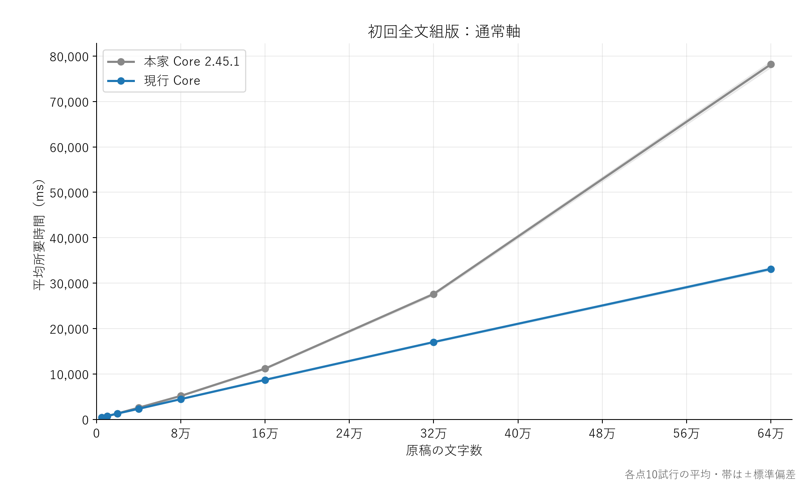
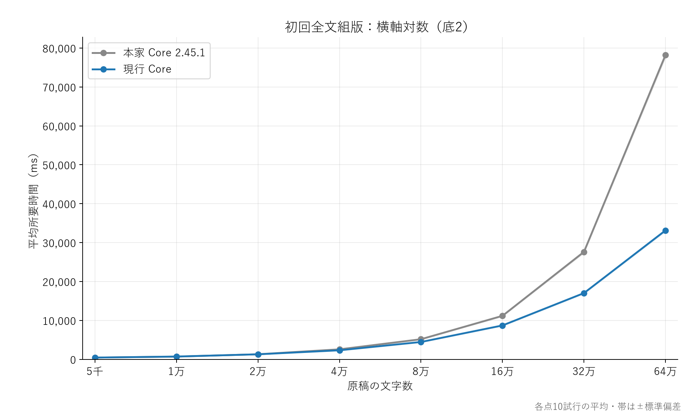
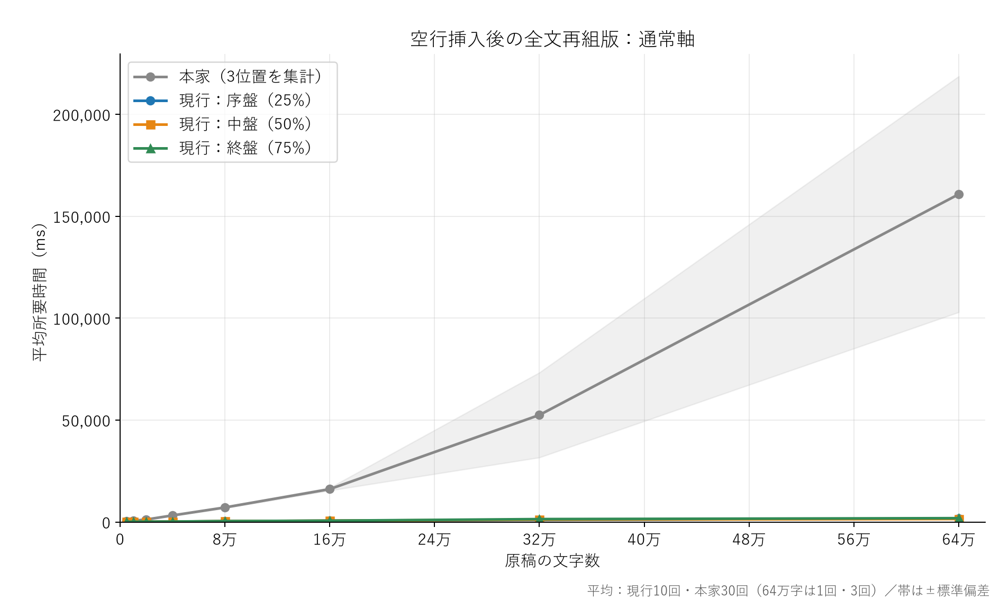
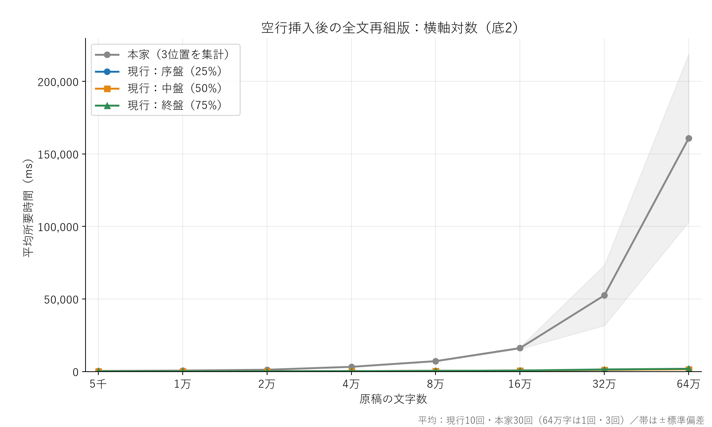
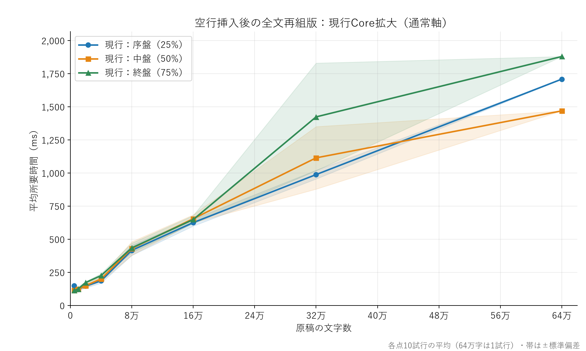
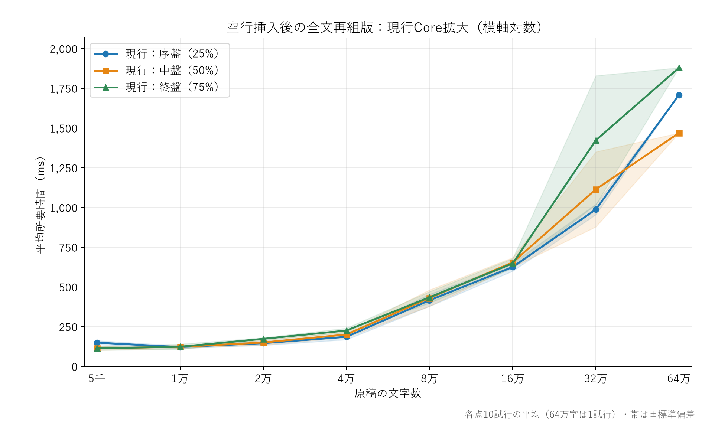
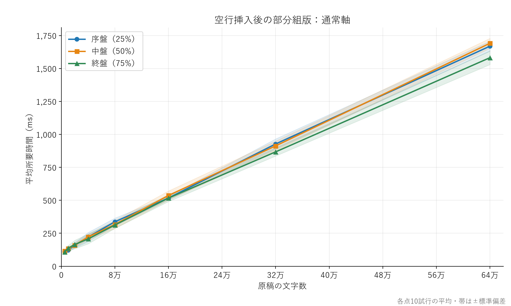
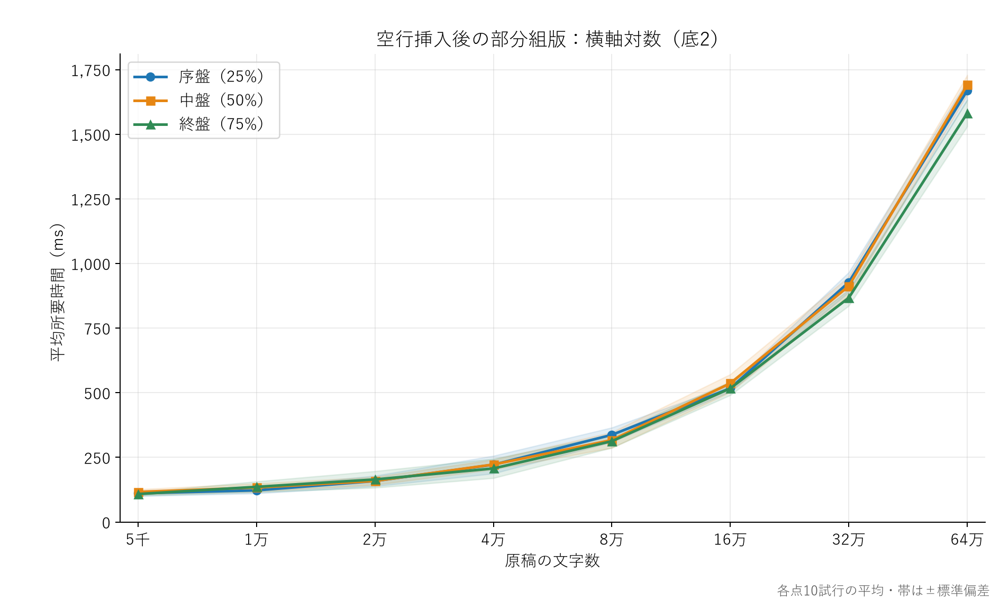

# 5千〜64万字の組版ベンチマーク

平均所要時間を掲載。初回・部分組版は各条件10試行。空行挿入後の全文再組版は32万字まで各10試行、64万字は各1試行。warmupは各条件1回を除外。文字数は5,000×2のべきで8段階。

## 初回全文組版

| 文字数 | ページ数 | 本家平均（ms） | 現行平均（ms） | 本家÷現行 |
| --- | ---: | ---: | ---: | ---: |
| 5,000 | 9 | 444.2 | 444.5 | 1.00倍 |
| 10,000 | 17 | 690.9 | 712.5 | 0.97倍 |
| 20,000 | 34 | 1,297.7 | 1,285.2 | 1.01倍 |
| 40,000 | 67 | 2,563.5 | 2,319.7 | 1.11倍 |
| 80,000 | 134 | 5,162.4 | 4,452.7 | 1.16倍 |
| 160,000 | 267 | 11,173.9 | 8,703.5 | 1.28倍 |
| 320,000 | 534 | 27,611.4 | 17,020.7 | 1.62倍 |
| 640,000 | 1,067 | 78,182.7 | 33,126.6 | 2.36倍 |





## 空行挿入後の全文再組版

本家の列は3位置を合わせた平均（32万字までは計30試行、64万字は計3試行）。現行は位置別の平均（32万字までは各10試行、64万字は各1試行）。

| 文字数 | 本家平均（ms） | 現行：序盤（ms） | 中盤（ms） | 終盤（ms） | ページ数（序盤／中盤／終盤） |
| --- | ---: | ---: | ---: | ---: | --- |
| 5,000 | 337.0 | 149.0 | 113.1 | 113.0 | 9／9／9 |
| 10,000 | 636.5 | 120.8 | 122.1 | 122.8 | 17／17／17 |
| 20,000 | 1,213.4 | 145.3 | 149.6 | 172.6 | 34／34／34 |
| 40,000 | 3,220.3 | 185.3 | 199.8 | 224.9 | 67／67／67 |
| 80,000 | 7,131.9 | 415.4 | 429.4 | 434.1 | 134／134／134 |
| 160,000 | 16,124.5 | 624.7 | 653.8 | 647.5 | 267／267／267 |
| 320,000 | 52,497.0 | 987.2 | 1,113.5 | 1,422.7 | 534／534／534 |
| 640,000 | 160,829.8 | 1,707.9 | 1,468.3 | 1,878.7 | 1,067／1,067／1,067 |









SVG版：[全文通常](complete-linear.svg)・[全文対数](complete-log.svg)・[現行拡大通常](complete-current-linear.svg)・[現行拡大対数](complete-current-log.svg)。


## 空行挿入後の部分組版

| 文字数 | 序盤平均（ms） | 中盤平均（ms） | 終盤平均（ms） | 全文ページ数（序盤／中盤／終盤） |
| --- | ---: | ---: | ---: | --- |
| 5,000 | 110.9 | 116.2 | 108.2 | 9／9／9 |
| 10,000 | 122.5 | 133.3 | 136.0 | 17／17／17 |
| 20,000 | 158.5 | 158.7 | 164.6 | 34／34／34 |
| 40,000 | 221.6 | 222.3 | 207.2 | 67／67／67 |
| 80,000 | 337.2 | 316.9 | 312.6 | 134／134／134 |
| 160,000 | 517.4 | 536.7 | 517.0 | 267／267／267 |
| 320,000 | 927.3 | 912.7 | 867.3 | 534／534／534 |
| 640,000 | 1,669.1 | 1,691.0 | 1,581.7 | 1,067／1,067／1,067 |





## 測定条件

原稿・CSSは[前回の本家比較](../本家比較ベンチマーク.md)と同じ。120字ごとの一意な段落、A6・縦書き・9pt・Yu Mincho・行送り1.75。空行一つを段落数の25%／50%／75%付近に追加する。初回はHTML解析を含むCore入力から全文loadedまで、部分組版はローカルseed複製開始から対象紙面のfocusedterminalまで。部分組版の未編集全文baselineは毎試行新規に作成し、その時間を主指標から除く。

部分組版の全文ページ数は、編集後の入力を本家で独立全文組版した比較用結果から記録する。対象は単ページであり、表示した紙面は1ページ。全試行を本家の全文結果に対して比較し、本文・寸法・左右・TextNodeの表示矩形の一致を確認した。

全文更新は、未編集原稿を全文完成させた既存Viewerへ空行追加後のHTMLを渡し、全文完成のloaded通知までを測る。現行はrefreshMemoryDocumentとreusePagesを使う。本家と現行の各位置・各試行で全紙面を照合する。

本家は比較対象の上流2.45.1。各試行は新しいブラウザページで逐次実行する。初回全文の本家／現行の順序を交代する。Markdown変換・IPC・描画フレーム待ちは含めない。グラフの縦軸はすべて線形、横軸だけ通常軸／対数軸を切り替える。

[全試行CSV](trials.csv)・[集計と環境JSON](results.json)。ページ数・対象ページ番号（1始まり）・補助時間も記録した。

SVG版：[初回通常](initial-linear.svg)・[初回対数](initial-log.svg)・[部分通常](focused-linear.svg)・[部分対数](focused-log.svg)。

## 再実行

Coreと本家比較用bundleを準備し、以下をリポジトリ直下で逐次実行する。グラフ生成にはMatplotlibを使用する。既定は8字数・各10試行・除外warmup各1回。途中で終了した測定は同じ出力先を指定して再開できる。

```console
npm run build --prefix vivliostyle/packages/core
node experiments/preview-benchmark/build-upstream-comparison.mjs
node experiments/preview-benchmark/run-scaling-comparison.mjs --timeout=600000 --output=.recovery/scaling-comparison/new-initial
node experiments/preview-benchmark/run-scaling-focused.mjs --output=.recovery/scaling-comparison/new-focused
node experiments/preview-benchmark/run-scaling-comparison.mjs --menus=edit --include-focused=false --reps640k=1 --timeout=600000 --output=.recovery/scaling-comparison/new-updated
python experiments/preview-benchmark/publish-scaling-comparison.py --updated=.recovery/scaling-comparison/new-updated --initial=.recovery/scaling-comparison/new-initial --focused=.recovery/scaling-comparison/new-focused --output=experiments/preview-benchmark/scaling-new
```
