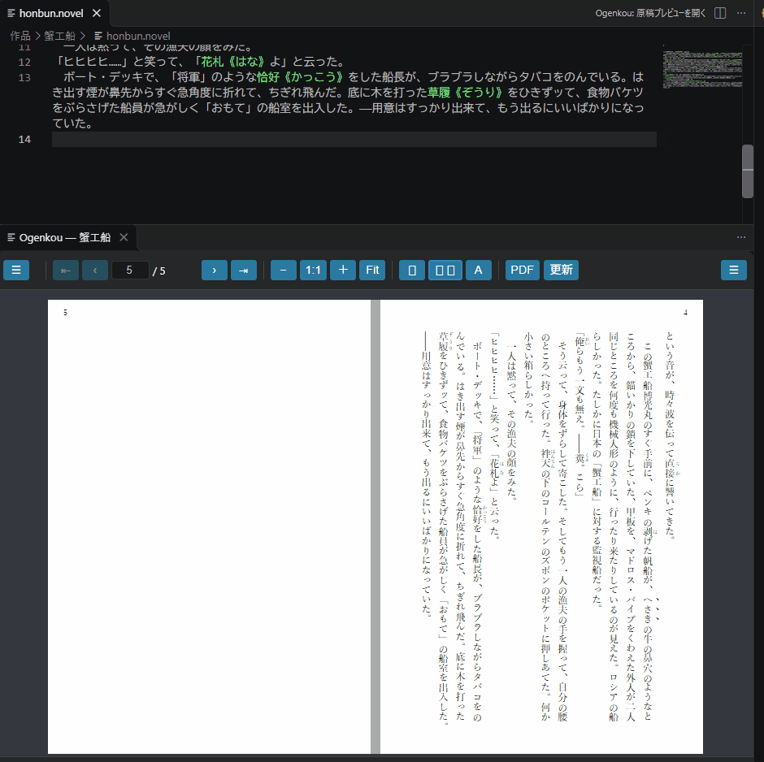
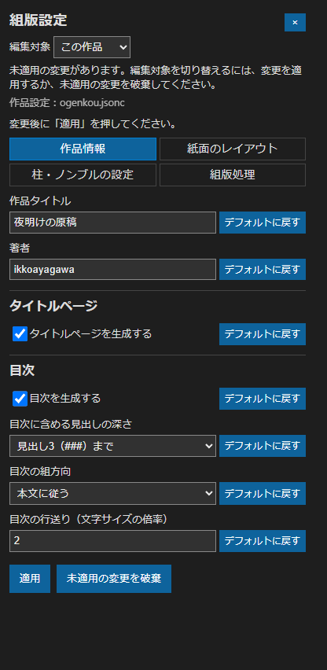

# お原稿（Ogenkou）

小説の原稿を書きながら、本にしたときの紙面を確認できるVS Code拡張機能です。

縦書きの行の収まり、ページをまたぐ台詞、章の始まり。文章だけでは気づきにくいところを、原稿の隣に開いたプレビューで確かめられます。紙面を整えたら、作品全体をPDFに書き出せます。



## 主な機能

- **保存を待たずにプレビューを更新。** 単ページ・見開き・ウィンドウ幅に合わせた自動表示に切り替えられます。
- **紙面の設定を画面から変更。** 用紙、組方向、フォント、文字サイズ、行送り、段組み、余白、柱・ページ番号を調整できます。
- **小説で使うルビと傍点。** `｜原稿《げんこう》`、`漢字《かんじ》`、`《《傍点》》` などを紙面へ反映します。
- **章ごとの原稿をまとめて組版。** 同じフォルダー直下の `.novel` / `.nv` を、ファイル名の自然順で結合します。
- **紙面から原稿へ移動。** 本文をクリックすると、対応する原稿の位置が開きます。
- **執筆中の確認を補助。** 文字数、Gitの最新コミットからの文字数の増減、正規表現によるハイライトを使えます。
- **PDFへ書き出し。** 未保存の原稿も含めて、プレビューと同じ作品設定から全文を組版します。

## インストール

0.9.0はVSIXファイルからインストールします。

1. VS Codeで「拡張機能」を開きます。
2. 上部の「…」から「VSIXからのインストール」を選びます。
3. 配布された `ogenkou-0.9.0.vsix` を選びます。再読み込みを求められたら、案内に従ってください。

ソースから作成する場合の手順は [リポジトリのREADME](https://github.com/ikkoayagawa/Ogenkou#readme) にあります。インストール後にNode.jsやVivliostyleを別途導入する必要はありません。

PDF出力にはChrome・Edge・Chromiumのいずれかを使用します。ブラウザーは拡張機能に同梱していません。現在の動作確認はWindows上で行っています。

## 最初のプレビュー

### 1. 作品フォルダーと原稿を作る

VS Codeで作品用のフォルダーを開き、`01_第一章.novel` のようなファイルを作ります。拡張子は `.novel` と `.nv` に対応しています。

```text
私の小説/
  01_第一章.novel
  02_第二章.novel
```

原稿は同じフォルダーの直下に置いてください。先頭に番号を付けると、章の順番を揃えやすくなります。サブフォルダーの原稿は結合しません。

```text
# 第一章

　窓の外には、まだ夜の色が残っていた。
　机の上の｜原稿《げんこう》に、最後の一行を書き足す。

「これで、ようやく始められる」
```

`#` で始まる行は見出しです。本文の改行・空行・字下げの扱いは、作品の組版設定で選べます。

### 2. プレビューを開く

原稿を開いて、エディター右上のボタン、またはコマンドパレットから **Ogenkou: 原稿プレビューを開く** を実行します。

初回は作品全体を組版するため、紙面が出るまで少し待ちます。進捗はプレビュー上部に表示されます。必要なファイルがまだない場合は、作品フォルダーに `ogenkou.jsonc` と `styles/custom.css` のひな形を作成します。

紙面が出たら、原稿を編集してみてください。自動更新は標準で有効です。保存前の変更も反映されます。

### 3. 紙面を読む・移動する

| 操作 | 動作 |
| --- | --- |
| 上部の表示切り替え | 単ページ・見開き・自動表示を選ぶ |
| 前後ボタン・ページ番号・下部のシークバー | ページを移動する |
| マウスホイール | ページを送る。見開きでは見開き単位で移動 |
| Ctrl＋ホイール | 倍率を変える |
| Ctrl＋左ドラッグ | 拡大した紙面の表示位置を動かす |
| 紙面の本文をクリック | 原稿の対応箇所へ移動する |
| 左側の「☰」 | 見出し一覧を開く |

倍率やフィット表示の変更では、紙面そのものの組版条件は変わりません。総ページ数に `*` が付いている間は、前回の全文組版で確定したページ数を表示しています。

## 紙面を整える

プレビュー右側の「☰」を開き、編集対象を「この作品」または「デフォルト」から選びます。「この作品」は今の原稿用、「デフォルト」は他の作品でも使う基本設定です。

設定画面には、次の4つのタブがあります。

| タブ | 主な設定 |
| --- | --- |
| 作品情報 | タイトル、著者、タイトルページ、目次、目次の組方向・行送り |
| 紙面のレイアウト | 用紙と向き、縦書き・横書き、段組み、文字、行送り、余白 |
| 柱・ノンブルの設定 | 柱とページ番号の位置・表記、柱の見出しの長さ |
| 組版処理 | 改行・字下げ、ルビ・傍点、縦中横、連続ダッシュなど |



変更後に「適用」を押すと、設定に合わせて組み直します。既存の `ogenkou.jsonc` を変更した場合は、VS Code上でも保存してください。未適用の変更がある間は編集対象を切り替えられません。「未適用の変更を破棄」で元へ戻せます。

タイトルページは、タイトルがある場合に作られます。タイトル・著者は「作品情報」で指定でき、原稿先頭のFrontmatterも補助入力として使えます。作品設定の指定を優先します。

目次は「作品情報」→「目次を生成する」で切り替えます。見出しから自動生成し、タイトルページの後、タイトルページがない場合は作品の先頭へ挿入します。含める見出しの深さや、目次だけを横書きにする設定も選べます。

## 対応する小説記法

```text
｜原稿《げんこう》を書く。
漢字《かんじ》に読みを添える。
ここは《《強調したい言葉》》です。
[[rb:親文字>読み]]
[[emphasismark:傍点を付ける本文]]
```

縦書きでは短い数字などの縦中横や、連続するダッシュをつなぐ表示も設定できます。ルビ・傍点の変換と、エディター上の色分けは別の機能です。ルビ・傍点専用の色分けは行いません。

## CSSでも調整する

標準の設定だけで組版できます。見出しなどをさらに調整したい場合は、作品の `ogenkou.jsonc` のトップレベルに次を追加し、`styles/custom.css` を編集します。

```jsonc
"style": "styles/custom.css"
```

CSSの例です。

```css
h1 {
  font-size: 1.5em;
  margin-block-end: 2em;
}
```

用紙・余白などの作品設定は `ogenkou.jsonc` に残ります。別作品へコピーして使い回す場合は、タイトル・著者やCSS・画像の参照先も確認してください。

## PDFに書き出す

プレビュー上部の **PDF**、または **Ogenkou: PDFを書き出す** を実行し、保存先を選びます。PDFでは作品全体の組版が完了するまで待ってから出力します。

Chrome・Edge・Chromiumが見つからない場合は、VS Codeの設定で `ogenkou.pdf.browserPath` を検索し、使用するブラウザーの実行ファイルを指定してください。

## 文字数とハイライト

ステータスバーに、現在の原稿と作品全体の文字数を表示します。標準ではルビの親文字を本文として数え、読みと小説記法は除きます。一般的なMarkdown記号は文字数に含まれます。VS Codeの設定から、空白・改行やルビの数え方を変更できます。

Git管理中の原稿では、現在のファイルについて、最新コミット（HEAD）からの文字数の増減も表示します。

独自のハイライトは、VS Codeの `settings.json` に設定できます。例えば、見直しの目印を付けるには次のように書きます。

```json
{
  "ogenkou.highlight.rules": [
    {
      "name": "見直しの目印",
      "pattern": "TODO|要確認",
      "flags": "u",
      "backgroundColor": "#fff2aa",
      "color": "#333333"
    }
  ]
}
```

## 困ったときは

- **プレビューが開かない：** `.novel` / `.nv` の原稿を開いているか確認してください。
- **表示を更新したい：** コマンドパレットから「Ogenkou: プレビューを更新」を実行します。復帰しない場合は「Ogenkou: プレビューを再起動」を試してください。
- **長い原稿や目次付きの作品で更新を待つ：** 初回は全文を組みます。編集中も、目次のページ参照やCSSなどの条件により全文を組み直すことがあります。
- **紙面が意図した見た目にならない：** 用紙・余白・フォントと、追加CSSを確認してください。フォントはPCに入っているものを使用します。

## ソースとライセンス

組版エンジンにはVivliostyle Coreのforkを使用しています。ソースとビルド方法は [Ogenkouリポジトリ](https://github.com/ikkoayagawa/Ogenkou)、Coreの追加機能は [Core fork](https://github.com/ikkoayagawa/vivliostyle.js) にまとめています。

ライセンスはAGPL-3.0-onlyです。対応ソースと第三者ライセンスの案内はVSIXに同梱しています。
